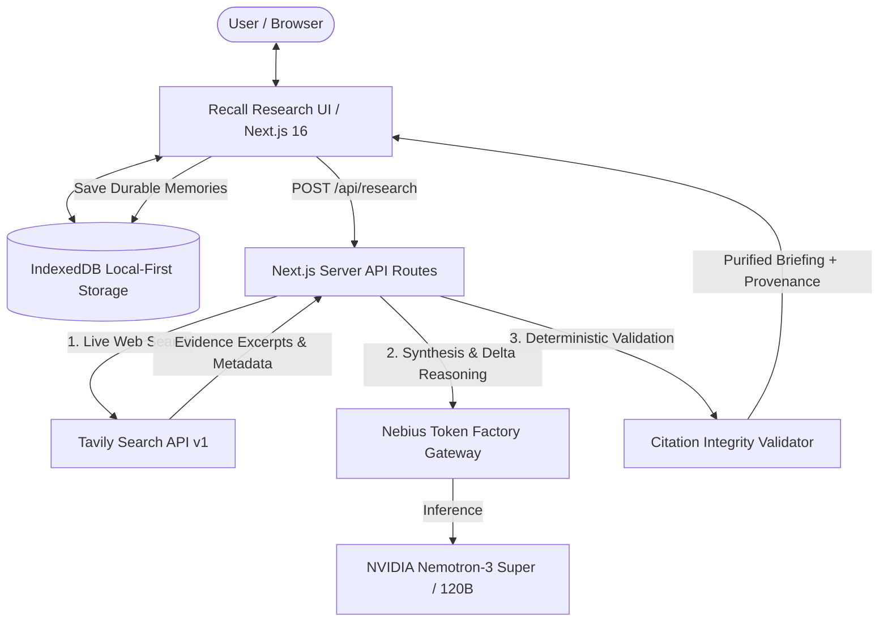

# Recall Research 🧠⚡

> **Research that remembers. Evidence that evolves.**  
> Built for the **Nebius x NVIDIA Global AI Hackathon** — *Best Apps & Agents Track*.

Recall Research is an AI research analyst that searches the live web, synthesizes source-backed briefings using **NVIDIA Nemotron** open models hosted on **Nebius Token Factory**, saves durable findings into user-controlled **persistent local memory**, and computes longitudinal **Research Deltas** when revisiting evolving topics over time.

---

## 🌟 The Problem & Why It Matters

Most AI research tools treat every query as an ephemeral, isolated interaction:
- Users repeat queries from scratch, losing prior insights.
- Chat histories lack structured memory, source provenance, and citation verification.
- When emerging topics evolve (solid-state batteries, open-source model releases, cloud platform announcements), users struggle to determine **what changed**, **what was corroborated**, and **what prior assumptions were contradicted**.

**Recall Research solves this with longitudinal research intelligence:**
1. **Real-time Web Grounding:** Calls Tavily API to retrieve live web sources, preserving publication dates and verbatim excerpts.
2. **Provider-Locked NVIDIA Nemotron on Nebius:** Real inference run strictly on Nebius Token Factory (`nvidia/nemotron-3-super-120b-a12b` for synthesis and comparisons; `nvidia/nemotron-3-nano-30b-a3b` for query planning and intent classification). Zero silent fallbacks to OpenAI, Gemini, or Ollama.
3. **Citation Integrity Validator:** Deterministically audits every citation ID (e.g., `[S1]`, `[S2]`) against the retrieved source pool to eliminate hallucinated references.
4. **Local-First Persistent Memory (IndexedDB):** Findings, sources, topics, and unresolved questions persist securely inside the user's browser across restarts—without requiring third-party hosted database accounts.
5. **Signature Feature: Research Delta:** Revisiting a topic compares previous findings against fresh evidence, automatically classifying shifts into **New Developments**, **Corroborated Facts**, **Contradicted Conclusions**, and **Unresolved Questions**.

---

## 🏗️ Technical Architecture



---

## 🚀 Key Features

### 1. Evidence-Backed Briefing Generation
- Detailed Executive Summary
- Core Key Findings with Confidence Ratings (`High`, `Moderate`, `Low`)
- Competing Viewpoints and Stakeholder Perspectives
- Chronology of Developments and Timeline
- Contradictions & Uncertainties (explicit acknowledgment of evidence limits)
- Open Questions and Recommended Follow-Up Investigations

### 2. Signature Research Delta (Longitudinal Comparison)
When you revisit an existing research topic or session, the engine compares historical findings with newly retrieved evidence:
- **🆕 New:** Developments supported by current evidence that were absent in previous sessions.
- **🤝 Corroborated:** Prior conclusions independently reaffirmed by recent reporting.
- **⚠️ Contradicted:** Recent evidence directly refuting or challenging an earlier conclusion.
- **❓ Unresolved:** Disputed or ambiguous issues where available data remains inconclusive.
- **ℹ️ Limitations:** Explicit boundaries disclosing scope, retrieval coverage, and date horizons.

### 3. Persistent Memory Library
- Local-first browser storage via **IndexedDB** (`RecallResearchDB`).
- Search by keywords, filter by topic, and toggle pinned items.
- Full CRUD: inspect provenance, edit titles/content inline, delete records permanently.
- Export complete structured backup as JSON.

### 4. Citation & Evidence Inspector
- Every claim cites a verified source pill `[S1]`, `[S2]`.
- Interactive inspector highlights source URLs, publication dates, and verbatim excerpts.
- One-click **Markdown Export (`.md`)** for offline review and documentation.

---

## ⚙️ Environment Configuration

Recall Research uses server-side environment variables to communicate with Nebius Token Factory and Tavily.

1. Copy the template:
   ```bash
   cp .env.example .env.local
   ```
2. Populate the required keys in `.env.local`:
   ```env
   # Nebius Token Factory OpenAI-compatible API
   NEBIUS_BASE_URL=https://api.tokenfactory.nebius.com/v1/
   NEBIUS_API_KEY=your_nebius_api_key_here

   # NVIDIA Nemotron Models on Nebius
   NEBIUS_MODEL_SUPER=nvidia/nemotron-3-super-120b-a12b
   NEBIUS_MODEL_NANO=nvidia/nemotron-3-nano-30b-a3b

   # Tavily Web Research API
   TAVILY_API_KEY=your_tavily_api_key_here
   ```

*Security Guarantee:* API keys are exclusively accessed in server-side API routes (`/api/research`, `/api/verify`). No secrets are ever sent to client bundles, local storage, or browser-visible variables.

---

## 🛠️ Development & Testing

### Prerequisites
- Node.js `v20+` or `v22+`
- npm `v10+` or `v11+`

### Installation
```bash
npm install
```

### Running Unit Tests
```bash
npm test
```
Runs 9 comprehensive unit tests covering:
- Citation ID validation and hallucination stripping
- Tavily input sanitization and prompt-injection defense
- Nebius JSON parser and markdown code block extraction
- Markdown report formatting and delta export

### Building for Production
```bash
npm run build
```

### Starting the Production Server
```bash
npm start
```
Open [http://localhost:3000](http://localhost:3000) to view the workspace.

---

## 🔍 Diagnostics & Integration Status

Recall Research includes a built-in diagnostic endpoint:
- **`GET /api/verify`**: Connects to the Nebius `/models` endpoint and Tavily `/search` endpoint to report authenticated connectivity, active Nemotron model IDs, and connection status without leaking credentials.
- Click the **Credentials / Setup** badge in the app header at any time to inspect real-time connection diagnostics.

---

## ⚠️ Known Limitations & Privacy Disclosure

1. **Third-Party Processing:** While knowledge is stored locally in the browser's IndexedDB, research queries are processed by Tavily, and selected evidence text and relevant memory context are transmitted securely to Nebius Token Factory for NVIDIA Nemotron inference.
2. **Device / Profile Scope:** IndexedDB is scoped to the specific browser profile and device. Cross-device synchronization is deliberately omitted to preserve local-first privacy.
3. **Delta Retrieval Scope:** The Research Delta classifies changes relative to the preserved records and retrieved search set; if a past record was not retained or a web page was paywalled, the delta explicitly attaches a limitation note.

---

## 📄 License

This project is licensed under the [MIT License](LICENSE).
